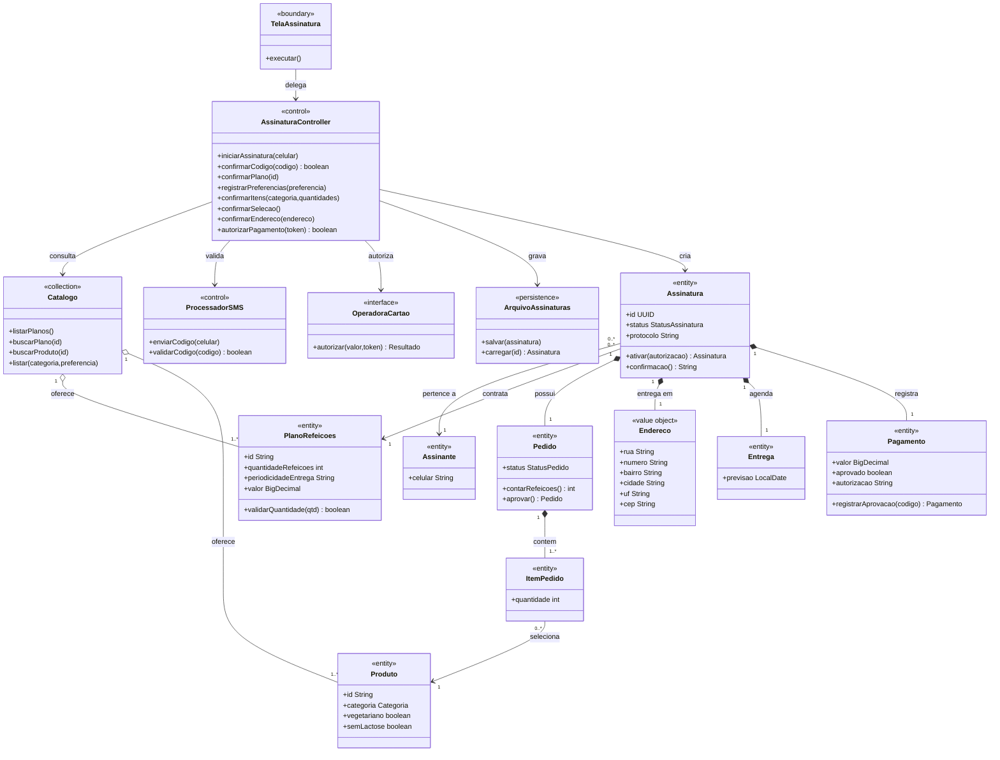
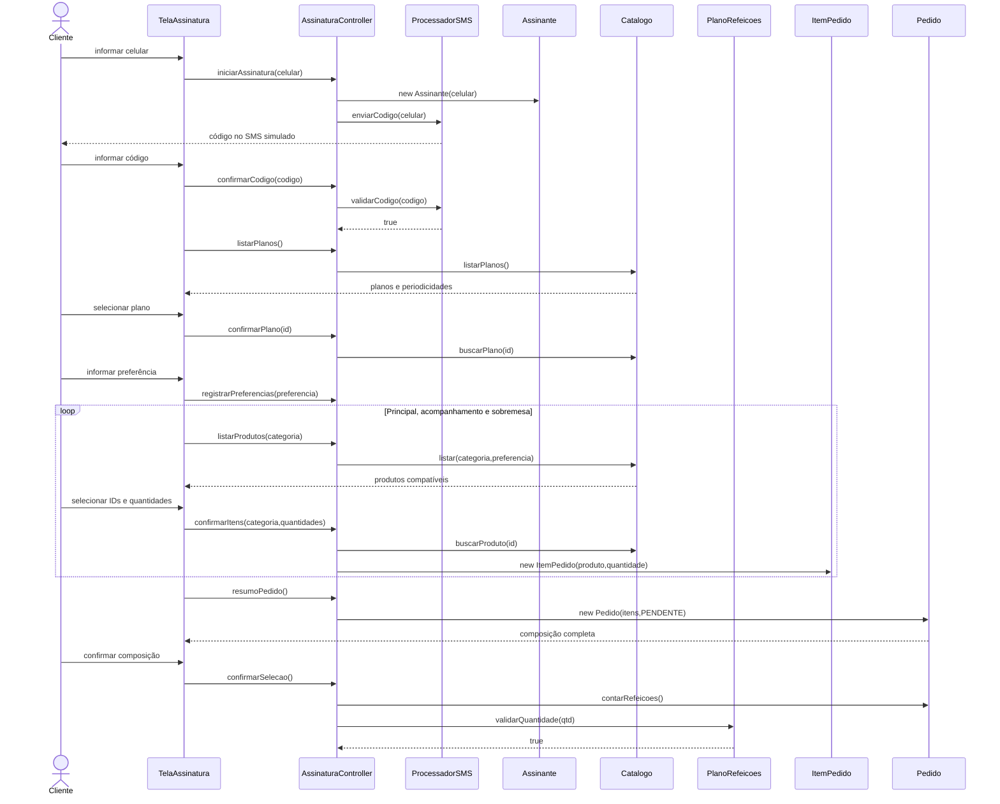
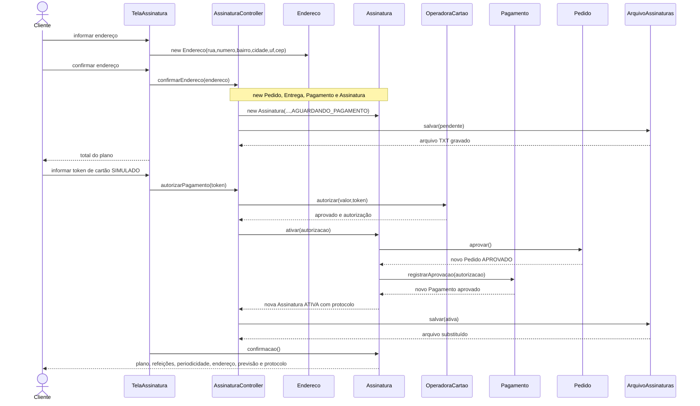
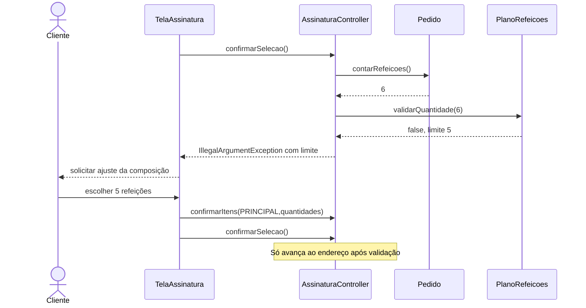
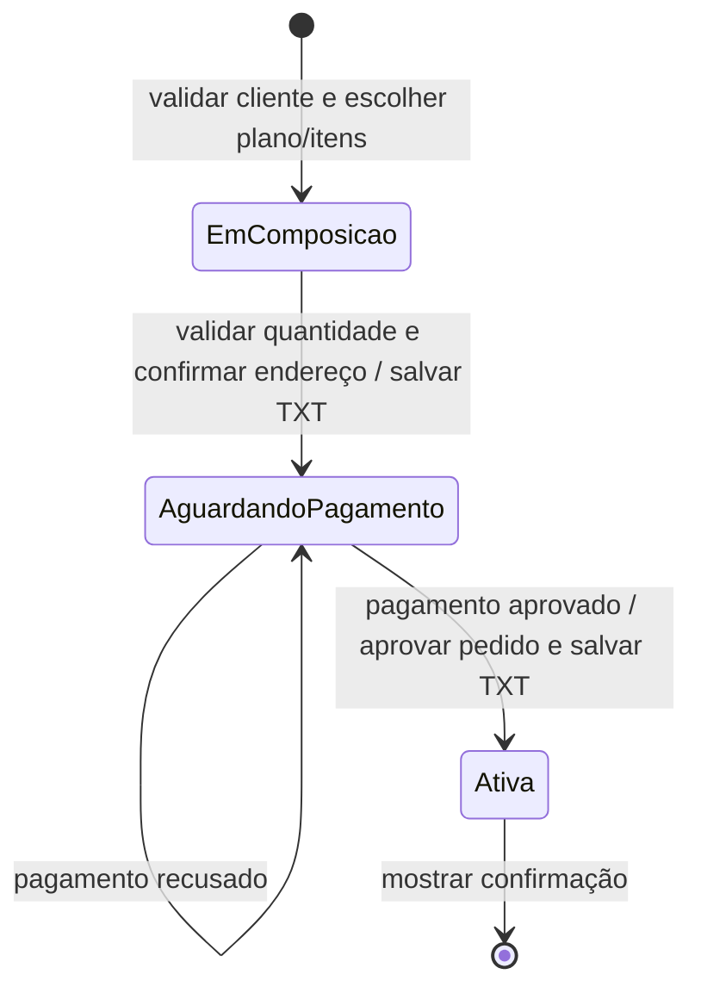

# Modelos da implementação — Minha Refeição

Versão de 15/11/2026, correspondente ao código da Entrega 4. Atualiza os modelos da Entrega 3 a partir do feedback da professora: inclui objetos de domínio antes ausentes, separa fluxos alternativos e explicita criação e persistência. Os modelos abaixo descrevem a implementação atual; não representam uma alteração retroativa dos arquivos já avaliados.

## Classes e responsabilidades



As entidades e objetos de valor usam `record` e cópias imutáveis de listas. As transições retornam novos objetos; `ativar()` não modifica um registro antigo em memória. `Catalogo` representa as coleções de planos/produtos; `ArquivoAssinaturas` concentra a leitura/gravação. Não se atribui ao arquivo a criação das entidades de negócio.

## Fluxo principal — validação e composição



O plano é o objeto selecionado por `confirmarPlano`. As mensagens de escolha confirmam um plano, uma preferência ou itens específicos.

## Fluxo principal — endereço, pagamento e conclusão



## FA1 — código inválido

```mermaid
sequenceDiagram
actor Cliente
participant Tela as TelaAssinatura
participant C as AssinaturaController
participant S as ProcessadorSMS
loop Até três tentativas inválidas
Cliente->>Tela: informar código inválido
Tela->>C: confirmarCodigo(codigo)
C->>S: validarCodigo(codigo)
S-->>C: false, decrementa tentativas
C-->>Tela: false
Tela-->>Cliente: erro e tentativas restantes
end
Note over S: Três erros inutilizam o código
Tela-->>Cliente: solicitar novo código ou encerrar
Cliente->>Tela: pedir novo código
Tela->>C: iniciarAssinatura(celular)
C->>S: enviarCodigo(celular)
Note over Cliente,S: Retorna à validação; não avança sem código válido
```

## FA2 — quantidade incompatível



## FA3 — pagamento não autorizado

```mermaid
sequenceDiagram
actor Cliente
participant Tela as TelaAssinatura
participant C as AssinaturaController
participant O as OperadoraCartao
Tela->>C: autorizarPagamento(RECUSAR)
C->>O: autorizar(valor,token)
O-->>C: aprovado=false
C-->>Tela: false
Note over C: Assinatura permanece AGUARDANDO_PAGAMENTO; pedido PENDENTE
Tela-->>Cliente: tentar outro token ou desistir
Cliente->>Tela: APROVAR
Tela->>C: autorizarPagamento(APROVAR)
C->>O: autorizar(valor,token)
O-->>C: aprovado=true e autorização
Note over C: Retorna ao registro de pagamento e ativação do fluxo principal
```

## Estados da assinatura



`EmComposicao` é um estado conceitual da interação; o registro `Assinatura` só é criado ao confirmar endereço. O código protege a ordem por uma enumeração interna de etapas.

## Correspondência com a Entrega 3

| Modelo anterior | Implementação atual | Justificativa |
|---|---|---|
| TelaAssinatura | TelaAssinatura | Fronteira de console |
| AssinaturaController | AssinaturaController | Orquestra as etapas |
| ServicoSMS | ProcessadorSMS + adaptador de saída | Limite de três tentativas; simulador explícito |
| CatalogoRepository | Catalogo | Coleções de planos e produtos, como solicitado no feedback |
| AssinaturaRepository | ArquivoAssinaturas | Grava objetos criados pelo controlador |
| ItemCardapio | Produto + ItemPedido | Separa o produto da quantidade escolhida |
| Assinatura/Pedido/Pagamento | Records homônimos | Transições imutáveis e persistência coerente |
| OperadoraCartao | Interface OperadoraCartao | Autorização simulada, substituível |
| Objetos faltantes | Assinante, Endereco, Entrega | Agora explícitos no modelo e no código |
| Sobremesas ausentes no PDF anterior | Categoria.SOBREMESA | Inclui passos 16–18 do enunciado original |

## Storyboard da fronteira

1. **Identificação:** campo de celular fictício, mensagem do simulador e campo de código. Erro mostra tentativas e oferece reenvio após o terceiro erro.
2. **Planos:** lista com quantidade, periodicidade e valor; confirmação por ID.
3. **Preferências:** tradicional, vegetariana, sem lactose ou vegetariana sem lactose.
4. **Cardápio:** listas filtradas, na ordem principal → acompanhamento → sobremesa; cada escolha tem ID e quantidade.
5. **Resumo:** composição completa e confirmação. Excesso retorna à seleção sem persistir uma adesão inválida.
6. **Endereço:** rua, número, bairro, cidade, UF e CEP; conferência antes de gravar adesão pendente.
7. **Pagamento:** total e token de simulação; recusa permite tentar novamente ou sair.
8. **Confirmação:** plano, itens, periodicidade, endereço, previsão, estados e protocolo.

Este storyboard documenta a fronteira implementada. Não equivale ao vídeo individual dos integrantes exigido para a Entrega 1.
